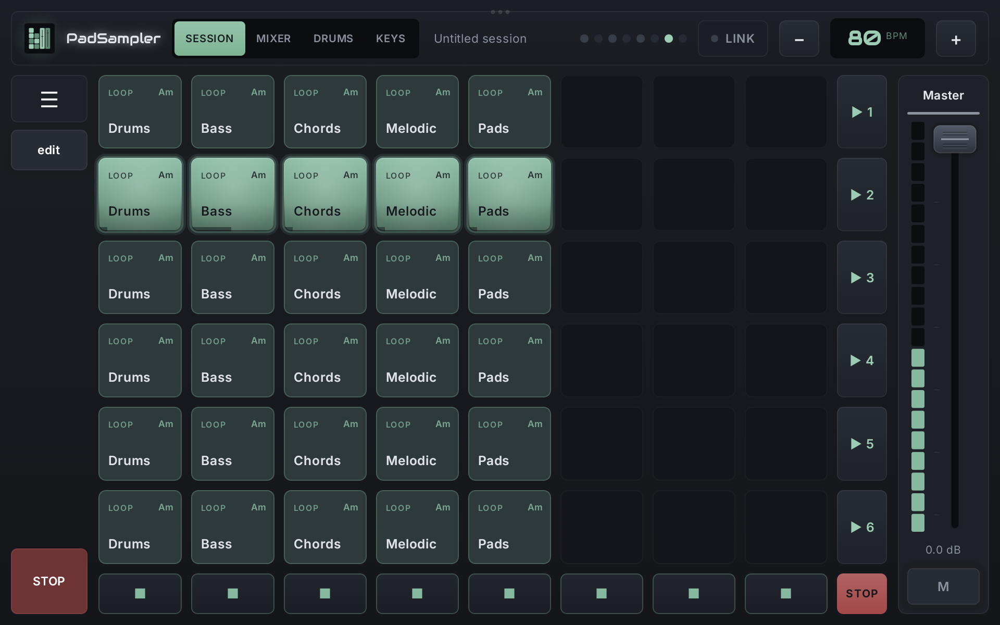
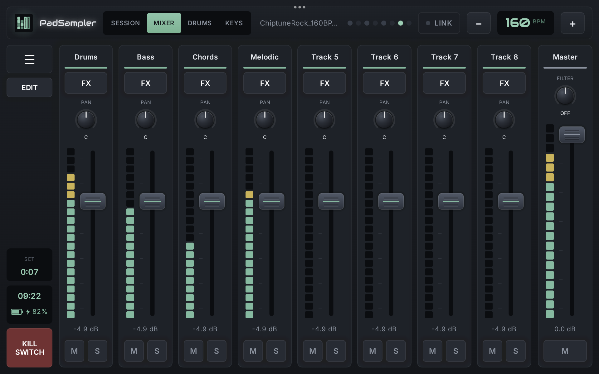
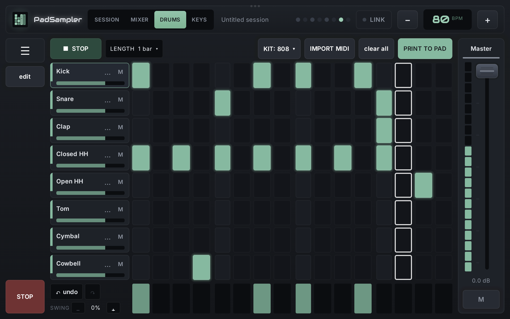
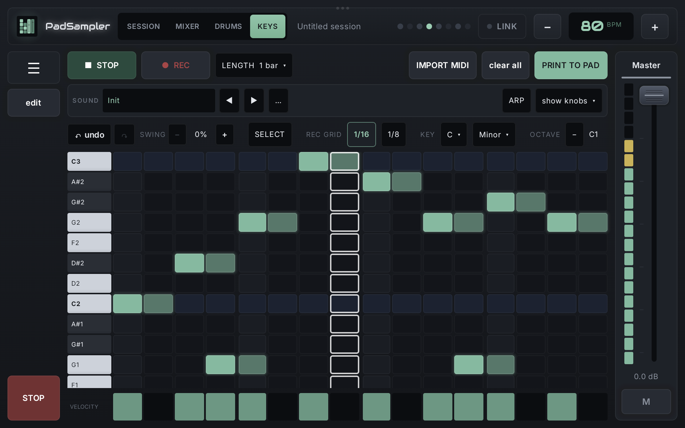
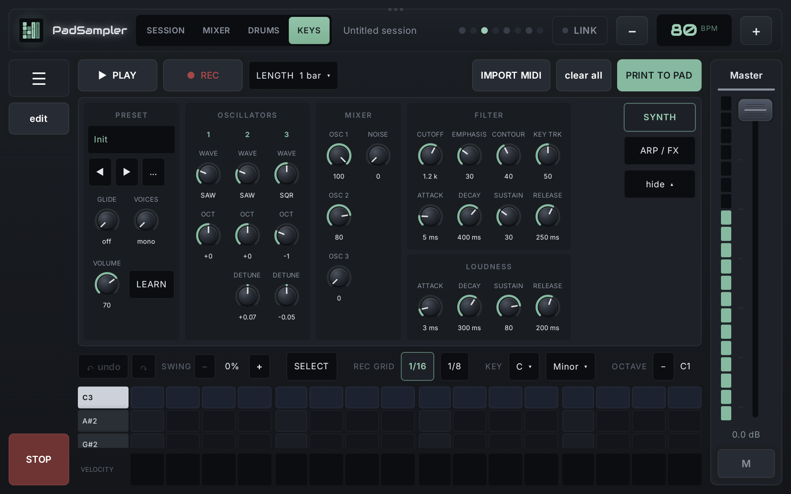

# PadSampler

**A live sampler for musicians — Android tablet, phone and Windows.**
Launch loops and one-shots from a clip grid, mix them, program drums and synth parts, and stay in sync with
Ableton Live and other apps over Ableton Link. Built for the stage: works offline and plays with a
Novation Launchpad Mini MK3.

By **[Nerd Instruments](https://nerd-instruments.net)** · Free and open source (GPL-3.0)

| Download | |
|---|---|
| **Windows** (free) | [Latest installer on GitHub Releases](https://github.com/rasxxb-hash/padsampler/releases/latest) |
| **Android** (tablet & phone) | Google Play — coming soon |
| **Manual** | [nerd-instruments.net](https://nerd-instruments.net) |



| Mixer | Drums |
|---|---|
|  |  |
| **Keys: piano roll** | **Keys: synth** |
|  |  |

---

## Features

**Session**
- 6 scenes × 8 tracks clip grid. One clip per track at a time, like the session view in Ableton Live.
- Clips start on the next bar (launch quantization). Clips are loops or one-shots.
- Launch whole scenes, stop tracks, stop all.
- Loads WAV, AIFF and MP3. Every sample keeps its original tempo and is **time-stretched** to the session
  tempo (Rubber Band), without changing the pitch.

**Mixer**
- A fader, level meter, mute, solo and pan for every track, plus a master channel.

**Drums**
- 8-lane step sequencer, 1–8 bars, swing, velocity per step, undo/redo.
- Built-in drum machine with 808, 909, Electro and Lo-Fi kits; every lane can be tuned and shaped
  (tune, decay, tone, snap, grit) — or load your own samples.
- **Import MIDI** drum files (General MIDI mapping).

**Keys**
- A three-oscillator, Minimoog-style synth with a 24 dB ladder filter, two envelopes, glide, mono and poly modes,
  and presets.
- Piano roll with scales, record live from the screen, the Launchpad or a MIDI keyboard (count-in, metronome,
  quantize), select and move notes.
- Arpeggiator (up, down, up/down, random, as played; rate, octaves, gate, hold).
- Effects: drive, chorus, tempo-synced ping-pong delay, reverb.
- **Import MIDI** files, MIDI keyboard with pitch bend and mod wheel, MIDI learn for every knob.

**Print to pad**
- Render a Drums or Keys pattern to a seamless loop on any pad, in time with the session.

**Sync and control**
- **Ableton Link**: shared tempo, beat and start/stop with Ableton Live and other Link apps on the same network,
  plus **Link Audio** (send the master output to Live).
- **Novation Launchpad Mini MK3**: clip grid, mixer, Drums and Keys pages with LED feedback.

**Sessions**
- Named sessions saved with copies of their samples; export/import as one `.padsession` file — move a set
  between tablet and computer.
- Set list for a live show, sample browser with preview.

**Made for live use**
- Everything works offline. The screen stays on, audio keeps running in the background (Android).
- Low latency: Oboe on Android, WASAPI or ASIO on Windows.
- Phone layout with large touch targets.

## Requirements

- **Android** 8.0 or newer (tablet recommended; phones work in landscape).
- **Windows** 10 or 11, 64-bit. For the lowest latency use an audio interface with an ASIO driver.
- Optional: Novation Launchpad Mini MK3 (USB), any class-compliant USB MIDI keyboard.

## Building from source

The Android app and the Windows app share the same Kotlin UI (`shared/`) and the same C++ audio engine
(`app/src/main/cpp/`).

### Android

1. Install [Android Studio](https://developer.android.com/studio) with Android SDK 35, **NDK** and **CMake 3.22.1**.
2. Open the project folder and let Gradle sync.
3. Build a debug APK:
   ```
   ./gradlew assembleDebug
   ```
   The APK is in `app/build/outputs/apk/debug/`.

Release builds are signed with a key that is **not** part of this repository. To sign your own release build,
create `~/.padsampler/keystore.properties`:
```
storeFile=/path/to/your-release.jks
storePassword=...
keyAlias=...
keyPassword=...
```
and run `./gradlew assembleRelease`. Without that file the release build is simply left unsigned.

### Windows

Requirements: Visual Studio 2022 Build Tools (C++), CMake, JDK 17 or newer.

1. Build the audio engine (`padsampler.dll`) and run the C++ tests:
   ```
   cmake -S desktop -B desktop\build -G "Visual Studio 17 2022" -A x64
   cmake --build desktop\build --config Release
   ctest --test-dir desktop\build -C Release --output-on-failure
   ```
   CMake downloads [RtAudio](https://github.com/thestk/rtaudio) on the first run.
2. Run the app, or build the installer:
   ```
   cd desktop-app
   .\gradlew.bat run
   .\gradlew.bat packageExe
   ```
   The installer is written to `desktop-app\build\installer\main\exe\`.

Audio device options (WASAPI/ASIO, device, buffer size) are in the app under ⚙, or via the environment variables
`PADSAMPLER_API`, `PADSAMPLER_DEVICE`, `PADSAMPLER_BUFFER` (more in [`desktop/README.md`](desktop/README.md) and
[`desktop-app/README.md`](desktop-app/README.md), in Bosnian).

### Project layout

| Folder | What is inside |
|---|---|
| `app/src/main/cpp/` | Shared C++ audio engine: mixer, sample bank and time-stretching, Ableton Link, Studio (sequencer, drum kit, synth, arpeggiator, effects), JNI bridge |
| `shared/` | Shared Kotlin code: view model, Compose screens, sessions, MIDI and Launchpad logic |
| `app/` | Android app (Oboe audio, Android MIDI, foreground service) |
| `desktop/` | Windows audio engine (RtAudio), JNI, C++ tests |
| `desktop-app/` | Windows app (Compose Desktop) and installer |
| `native-tests/` | C++ tests for the mixer, decoder, sample bank, Link, Studio and synth |
| `docs/` | Detailed behaviour specification (in Bosnian) |

## Support development

PadSampler is free on every platform and has no ads. If it helps your music, you can
[buy me a coffee via PayPal](https://paypal.me/padsampler).

## License

PadSampler is free software: you can redistribute it and/or modify it under the terms of the
**GNU General Public License, version 3 or later** — see [`LICENSE`](LICENSE).
Copyright © 2026 Nerd Instruments.

It uses third-party libraries and fonts under their own licenses (Rubber Band, Ableton Link, Asio, Oboe,
RtAudio, dr_mp3, Audiowide, Inter and others) — see [`THIRD_PARTY_NOTICES.md`](THIRD_PARTY_NOTICES.md) and the
[`licenses/`](licenses) folder. The same information is in the app under **☰ → About**.

The Android version on Google Play is a free build of exactly this source code. You are also free to build
it yourself.

PadSampler is an independent project and is not affiliated with Ableton, Novation/Focusrite or Steinberg.
Ableton and Link are trademarks of Ableton AG; Launchpad is a trademark of Focusrite Audio Engineering Ltd.;
ASIO is a trademark of Steinberg Media Technologies GmbH.
